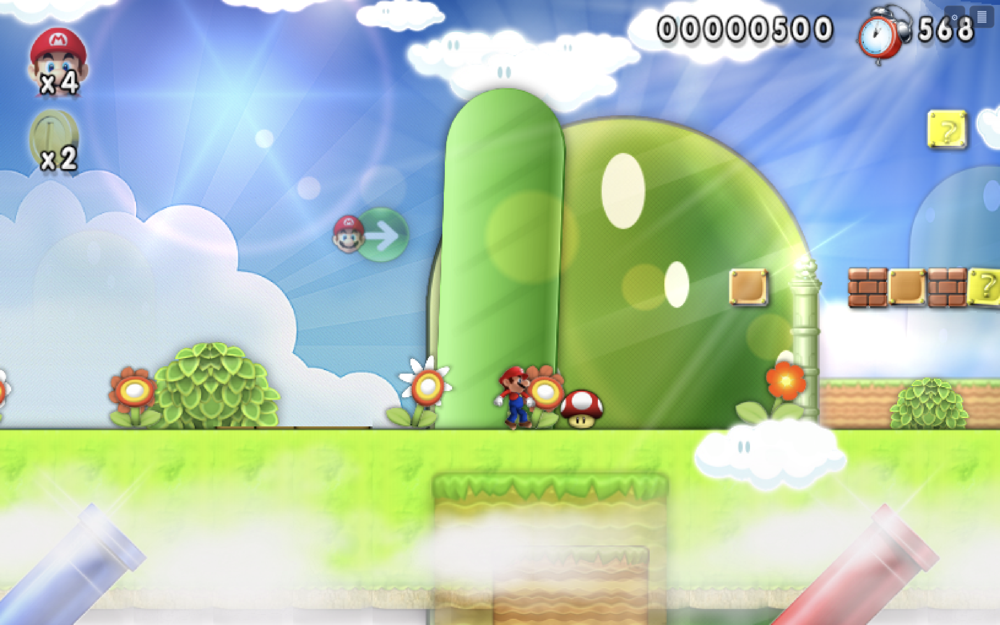
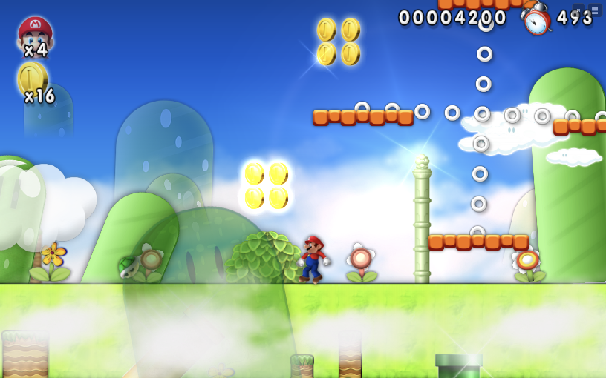
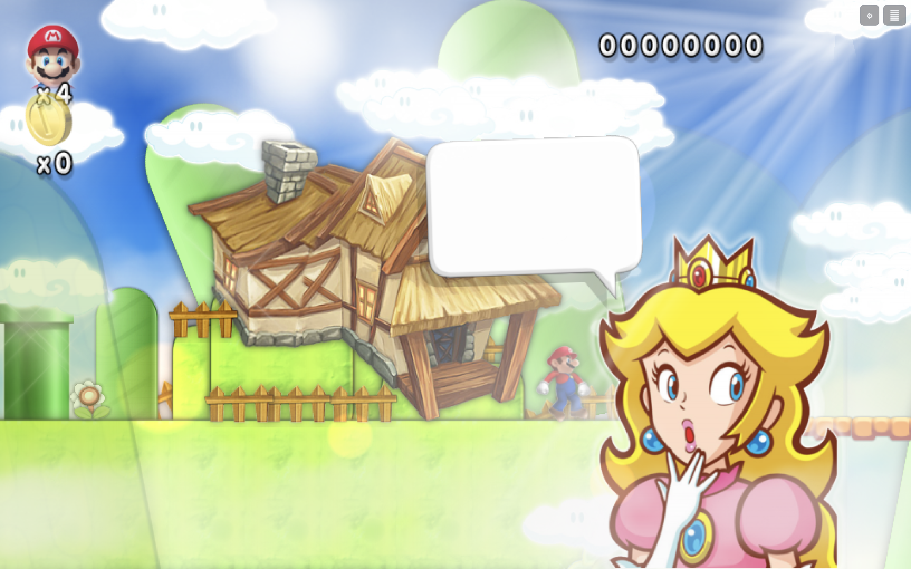
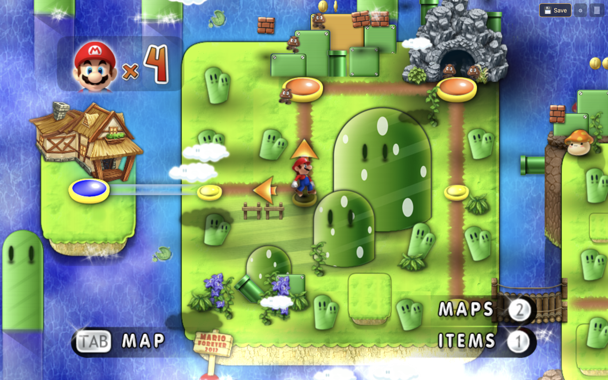
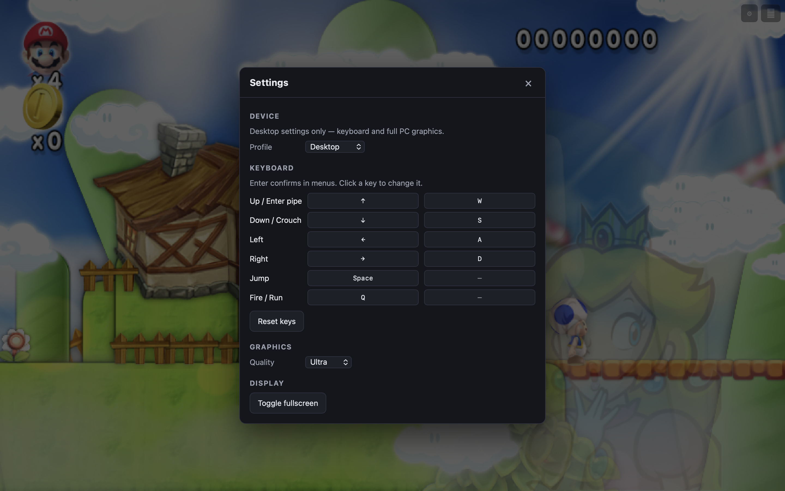
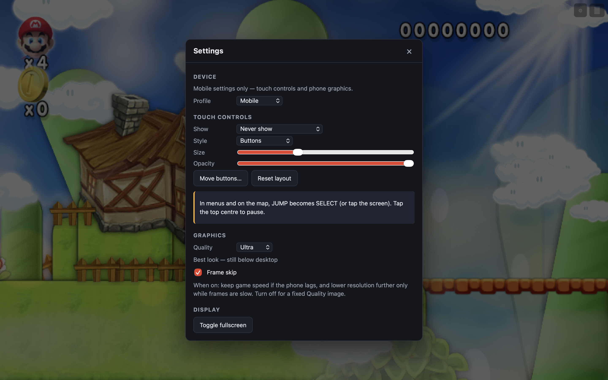
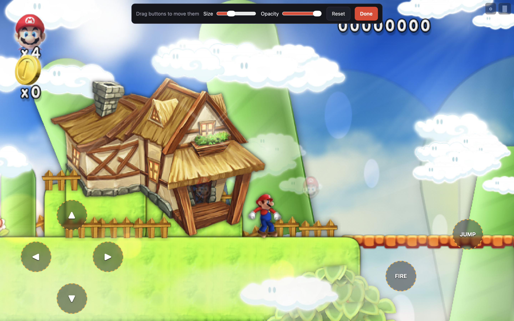
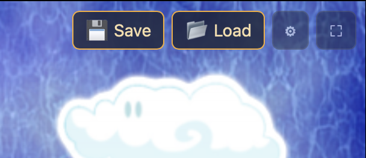

# Mario-Forever-2012-Rebuild

🎮 **Play Online:** [https://marioforever.duckdns.org/](https://marioforever.duckdns.org/)

A modern browser port of *New Super Mario Forever 2012* (GameMaker 8.1). The original GML game logic is compiled to JavaScript and runs on a custom GM8-compatible WebGL2 + Web Audio engine with mobile touch support, customizable layouts, save state management, and peer-to-peer multiplayer.

---

## 📸 Screenshots & Highlights

| Gameplay - Overworld Stage | Gameplay - Underground Stage |
| :---: | :---: |
|  |  |

| Title & Intro | World Map & Touch HUD |
| :---: | :---: |
|  |  |

| Desktop Settings (Keybindings & Graphics) | Mobile Settings & Customization |
| :---: | :---: |
|  |  |

| Drag & Move Buttons Anywhere | World Map HUD (Save & Load) |
| :---: | :---: |
|  |  |

---

## 🕹️ Controls & Features Guide

### 💾 1. Save & Load Progress
- **Save Progress (`💾 Save`)**: Whenever you are on a World Map, a gold **💾 Save** button appears on the top-right HUD bar. Click it anytime to download your full game state as a `.json` backup file (`mario-forever-2012-save-YYYY-MM-DD.json`).
- **Load Progress (`📂 Load` & `LOAD GAME`)**:
  - **World Map HUD**: A convenient **📂 Load** button is located directly beside **💾 Save** on all world maps, allowing you to quickly import and restore your save file on the fly without returning to the title menu.
  - **Title Screen**: Select **LOAD GAME** on the main Title Menu to upload your previously downloaded save file and restore all unlocked worlds, stages, and progress across any browser or device.

### 🗺️ 2. World Map Controls (ITEMS & MAPS)
- **Touch Devices**: Large, accessible **MAPS** and **ITEMS** buttons appear automatically at the bottom of the screen on world maps.
  - **ITEMS**: Opens your stored inventory items and power-ups.
  - **MAPS**: Opens the map selection and sub-world navigation menu.
- **Keyboard Users**: Press key `1` for **ITEMS** and key `2` for **MAPS** (matching the original PC release).

### ⚙️ 3. Settings & HUD
Click the gear icon (**⚙**) on the top-right corner anytime to open the Settings modal:
- **Profile Selector**: Switch between **Auto detect**, **Desktop**, or **Mobile** profiles.
- **Fullscreen (⛶ / F11)**: Click the **⛶** icon or press **F11** to toggle borderless fullscreen.
- **Top Center Pause Zone**: Tapping or clicking the top-center HUD bar during gameplay pauses and resumes the game.

### 💻 4. Desktop Mode & Custom Keybindings
When set to **Desktop Profile** (default on PCs and laptops):
- **Keyboard Bindings**: Click any action key slot in Settings to rebind it to your preferred keys. Supports primary and alternate keys for:
  - **Move Left / Right**: `←` / `→` or `A` / `D`
  - **Jump / Confirm**: `Space` or `Z`
  - **Fire / Sprint**: `Q` or `Shift` or `X`
  - **Crouch / Enter Pipe**: `↓` or `S`
  - **Enter**: Confirm menus
- **Reset Keys**: Easily restore factory default bindings at any time.

### 📱 5. Mobile Mode & Touch Controls
When set to **Mobile Profile** (auto-detected on phones and tablets):
- **Touch Mode**: Toggle between **Auto**, **Always show**, or **Never show**.
- **Control Styles**:
  - **Buttons**: On-screen directional D-Pad with dedicated **JUMP** and **FIRE** action buttons.
  - **Swipe**: Left thumb virtual joystick + right-hand tap/swipe gestures for jumping and sprinting.
- **Button Size & Opacity**: Adjust sliders to scale buttons up or down and adjust transparency to suit your screen.

### 🖐️ 6. Move Buttons Anywhere (Draggable Layout)
Want a custom button layout for your phone or tablet?
1. Open **Settings (⚙)** $\to$ select **Touch Controls**.
2. Click **"Move buttons..."** to enter the live layout customizer.
3. **Drag any button** (`◀`, `▶`, `▲`, `▼`, `JUMP`, `FIRE`) to any position on your screen for maximum comfort.
4. Tweak **Size** and **Opacity** in real-time, then tap **Done** to save your personal layout (or **Reset** to return to defaults).

### 🎨 7. Graphics Quality & Frame Skip
- **Quality Tiers**: Choose between **Low**, **Medium**, **High**, and **Ultra** graphics tiers to match your device's GPU capabilities.
- **Frame Skip (Mobile Performance)**:
  - Keeps game speed and physics consistent at 60 FPS even if hardware frame rates dip.
  - Dynamically adapts resolution during heavy action scenes to eliminate lag on mobile devices.

---

## Play Locally

```sh
cd web
npm install
npm run dev      # http://localhost:5173
npm run build    # static site in web/dist
```

- **Multiplayer**: MULTIPLAYER on the title menu starts a peer-to-peer race. One player creates a room and
  shares the 5-letter code (the public PeerJS server is only used to connect), picks a stage, and both play it
  at once, seeing each other as a ghost. Score = coins × 50 + enemies (100–500 by type) + 3000 for finishing
  + a time bonus − 500 per death. Races never write to your saves.
- Changes to the original game code (menu entries, skipped intro screens, removed links) are listed in
  `web/compiler/patches.ts`.

## Layout

- `web/src/runtime/` – engine: room loading, GM8 frame order, collisions, drawing, input, audio, particles.
- `web/src/ui/` – web layer: loading screen, settings, touch controls, save download, multiplayer race.
- `web/compiler/` – GML parser and JavaScript code generator.
- `web/src/generated/game.js` – compiled game code.
- `web/public/` – game assets (sprites, backgrounds, rooms, music, sounds).
- `export/` – scripts, objects and rooms exported from the original game; input to the compiler.
- `tools/` – `gm8export` (Rust, uses OpenGMK's `gm8exe`) and `decode_gfx.py` for re-exporting from the original exe.

After changing the compiler or runtime asset handling, run `npm run build:data` in `web/` to regenerate
`web/public/assets` and `game.js`.

## Known gaps

- PlayStation `.psf` music tracks and `.snd` sound effects have no browser decoder.
- `path_start` uses a simplified straight-line follower.

Fan project; Mario characters and assets belong to Nintendo.
